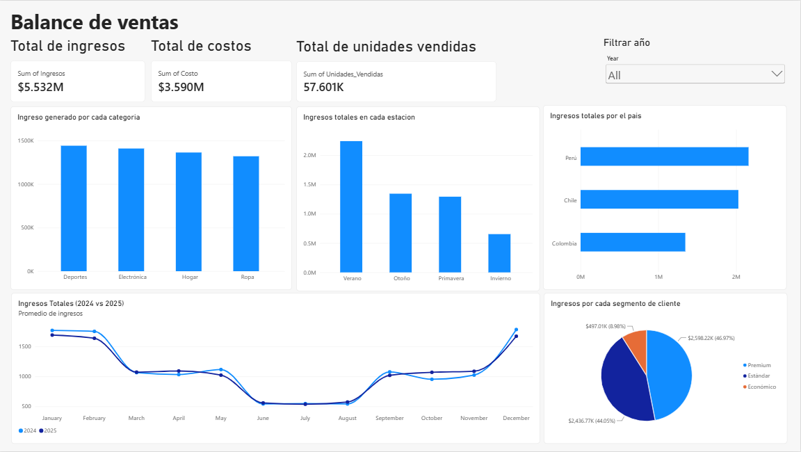
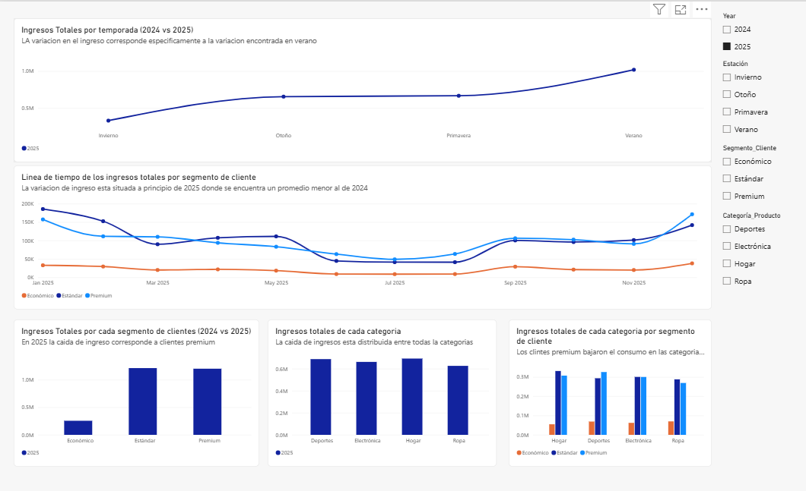
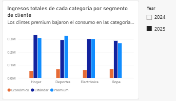

# Diagnosing the 2025 Revenue Decline in a Three-Country Retail Business

A Power BI analysis of 2024–2025 retail sales in Peru, Chile and Colombia to find out why 2025 revenue fell. Revenue followed the same seasonal curve in both years, so the decline was not structural. It traces to the Summer season and to Premium customers, who generate 46.97% of the $5.532M total revenue and cut spending on Home, Electronics and Clothing.

## Business Question

Management needed to know whether the 2025 revenue decline signaled a structural collapse or a temporary pattern. They also needed to know where it came from (season, customer segment or product category) and what to do about it.

The solution has two levels:

1. **Overview Dashboard:** a macro view for executives covering financial health, year-over-year (YoY) trends and business distribution.
2. **Detail View:** an exploratory view that isolates the root causes of revenue fluctuations.

## Data

- **Source:** transactional retail sales dataset (source name not specified).
- **Coverage:** sales in Peru, Chile and Colombia, 2024–2025.
- **Volume:** 57,601 units sold, $5.532M total revenue, $3.590M total cost.
- **Dimensions analyzed:** country, product category, customer segment (Premium, Standard, Budget) and season.

## Process

1. **Exploratory phase and metric framing:** defined the core KPIs and the business dimensions (country, category, customer tier, seasonality).
2. **Iterative design and UX refinement:** overlaid 2024 and 2025 monthly revenue on one 12-month axis to test for a structural decline and confirm recurring seasonality.
3. **Root-cause diagnostics:** used cross-filtering in the Detail View to narrow the drop to Summer, then Premium clients, then the Home, Electronics and Clothing categories.
4. **Strategic SCQA formulation:** synthesized the findings into executive-ready communication (Situation, Complication, Question, Answer), with generative AI used to help structure the storytelling and generate root-cause hypotheses.

**Data model:** *(add star schema image, e.g. `images/data-model.png`)*

**Main DAX measures:** *(add 1–2 code examples, e.g. total revenue, YoY comparison)*

### Dashboard Walkthrough

**Overview Dashboard**

- **Executive KPI cards:** Total Revenue ($5.532M), Total Cost ($3.590M) and Units Sold (57.601K).
- **Revenue trend (2024 vs. 2025):** monthly lines overlaid on one axis show a predictable seasonal cycle in both years.
- **Distribution:** Peru leads revenue ($2.2M+), followed by Chile ($2.0M+) and Colombia ($1.3M+). Sports is the top category ($1.4M+), followed by Electronics, Home and Clothing.
- **Customer segments:** Premium ($2.598M, 46.97%) and Standard ($2.436M, 44.05%) generate 91.02% of sales. Budget clients contribute 8.98% ($497K).

**Detail View**

- **Seasonal comparison:** Winter, Autumn and Spring are virtually identical across years, so the YoY gap sits entirely in Summer.
- **Monthly segment timeline:** shows periods where Premium spending dipped below Standard.
- **Segment comparison 2024 vs. 2025:** the 2025 contraction comes from reduced Premium spending.
- **Category comparison 2024 vs. 2025:** performance across Sports, Electronics, Home and Clothing.
- **Category x segment cross-analysis (filtered to 2025):** Premium cuts hit Home, Electronics and Clothing, while Sports stayed resilient.

## Findings

1. **The decline is seasonal, not structural.** Both years follow the same cyclical curve, with a sharp ~70% revenue drop in the summer months (June–August).
2. **Premium customers drove the 2025 decline.** Premium accounts for 46.97% of revenue ($2.598M) and reduced spending on Home, Electronics and Clothing.
3. **Sports is the resilient category.** It is the top revenue category ($1.4M+) and the only one where Premium customers kept strong purchasing habits in 2025.

## Recommendations

1. **Anti-cyclical summer strategy (June–August):** run targeted mid-year campaigns, product bundles and seasonal promotions to stabilize cash flow.
2. **Premium client retention program:** offer personalized loyalty incentives, exclusive offers and dedicated outreach to high-value clients.
3. **Cross-selling via Sports:** use Sports as an entry point to cross-sell Home and Electronics products.

## How to Open

- **Power BI:** download the `.pbix` file (*add file name*) and open it with Power BI Desktop.

## Tools

- **Power BI Desktop:** data modeling, interactive dashboard design and UI/UX optimization.
- **DAX:** time-intelligence measures, YoY comparisons and conditional formatting.
- **Generative AI (Gemini & ChatGPT):** data interpretation, SCQA structuring, root-cause hypotheses and executive report drafting.
- **Markdown & Git:** documentation and version control on GitHub.
